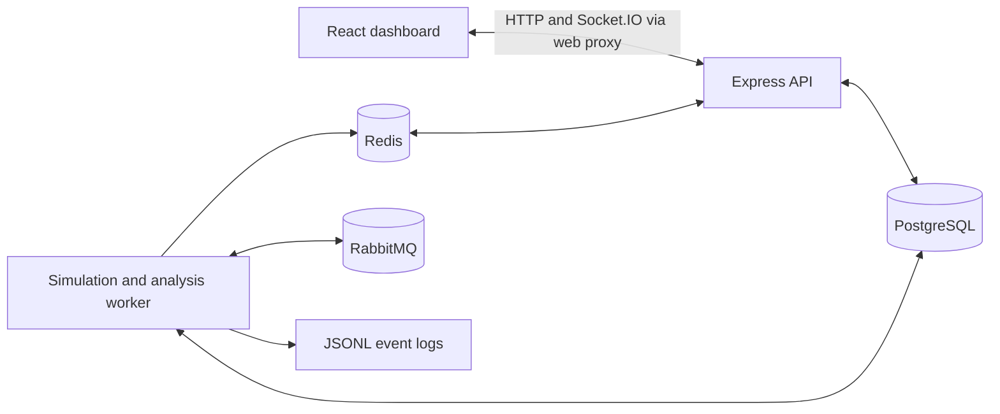

<div align="center">

# AERQYN

**A virtual drone lab for exploring flight data and cybersecurity.**

Watch three simulated drones, introduce sensor anomalies, and follow the alerts from detection to replay.

**[Explore the hosted preview](https://aerqyn.vercel.app)**

[Features](#what-you-can-do) &middot; [Setup](#run-the-full-app) &middot; [Walkthrough](#try-your-first-mission) &middot; [Development](#development) &middot; [Documentation](#documentation)

</div>


## Start here

AERQYN is a learning project that brings together a real-time dashboard and a secure backend. Its digital twin is a software simulation of a small drone fleet: position, speed, battery, and connection status update as each mission runs.

- **Just exploring?** Open the hosted preview above. No installation or login is needed.
- **Want to run missions?** Follow the setup below for the complete app, including authentication, live telemetry, alerts, and replay.
- **Interested in the code?** Start with [how it works](#how-it-works) and the [repository map](#repository-map).

> The hosted preview uses animated sample data. It does not connect to the backend, accept mission commands, or save changes. All drones and anomalies in AERQYN are synthetic; the project never connects to physical drones.

## What you can do

| Feature            | What it offers                                                                                        |
| ------------------ | ----------------------------------------------------------------------------------------------------- |
| Mission control    | Create, edit, launch, stop, and restart simulated flights.                                            |
| Live monitoring    | Follow three drones on a 2D field with telemetry cards and connected-viewer counts.                   |
| Anomaly simulation | Inject GPS jumps, battery drops, or communication loss and watch rule-based detection produce alerts. |
| Flight replay      | Play back and scrub through saved telemetry snapshots from previous runs.                             |
| Role-based access  | Use a Researcher account to control missions or an Observer account to view them.                     |
| Event history      | Keep alerts and replay snapshots in PostgreSQL, with timestamped JSONL event logs on disk.            |

See more [screenshots and the recorded walkthrough](docs/DEMO.md).

## Run the full app

### 1. Get the repository

Install **Git** and **Docker Desktop**, or Docker Engine with Compose v2 that supports `up --wait`. Start Docker before continuing. The complete Docker setup builds the app inside containers, so a host Node.js installation is optional.

```sh
git clone https://github.com/sumaidbinomar/AERQYN.git
cd AERQYN
```

Run all setup commands from this repository folder.

### 2. Set up your environment

Copy [`.env.example`](.env.example) to a new file named `.env`.

**PowerShell**

```powershell
Copy-Item .env.example .env
```

**macOS / Linux**

```sh
cp .env.example .env
```

Open `.env` in your editor and replace the placeholder values:

| Setting                        | What to enter                                                                                                                                                                      |
| ------------------------------ | ---------------------------------------------------------------------------------------------------------------------------------------------------------------------------------- |
| `POSTGRES_PASSWORD`            | Your database password. Use URL-safe characters, such as letters and numbers.                                                                                                      |
| `RABBITMQ_PASSWORD`            | A separate broker password, also URL-safe.                                                                                                                                         |
| `JWT_SECRET`                   | A randomly generated secret of at least 32 characters. A password manager can generate one.                                                                                        |
| `DEMO_RESEARCHER_PASSWORD`     | A password of 12–128 characters for the account that controls missions.                                                                                                            |
| `DEMO_OBSERVER_PASSWORD`       | A different password of 12–128 characters for the viewing account.                                                                                                                 |
| `DATABASE_URL`, `RABBITMQ_URL` | Replace the password placeholders with the matching passwords above. These URLs are used for host development and integration tests; Docker supplies its own internal connections. |

You can keep the example account emails or set two distinct emails of your own. Keep `.env` private; it is excluded from Git. Never put secrets in `VITE_*` variables, which are exposed to the browser.

### 3. Start the services and create the demo accounts

```sh
docker compose config --quiet
docker compose up --build -d --wait --wait-timeout 180
docker compose exec api node apps/api/dist/seed-cli.js
docker compose ps
```

The first build may take a few minutes. You should see six healthy services: web, API, worker, PostgreSQL, Redis, and RabbitMQ. Database migrations run automatically when the API starts; the seed command creates or updates your two demo accounts.

### 4. Open the dashboard

In Docker Desktop, expand the **aerqyn** stack and open the published port for **web**. With Docker Engine, open your machine's loopback address in a browser on port **5173**, or the `WEB_PORT` you configured.

Sign in using the matching email and password from `.env`:

| Account    | Default email             | Permissions                                                             |
| ---------- | ------------------------- | ----------------------------------------------------------------------- |
| Researcher | `researcher@aerqyn.local` | View, create, edit, delete, start, and stop missions; inject anomalies. |
| Observer   | `observer@aerqyn.local`   | View missions, live telemetry, alerts, and replay.                      |

There are no shared default passwords or public registration. Permissions are enforced by the backend.

### Stop or update the app

```sh
# Stop the services while keeping saved data
docker compose down

# Rebuild and start after source changes
docker compose up --build -d --wait --wait-timeout 180
```

Named Docker volumes preserve database records, broker data, Redis data, and event logs. Adding `-v` to the stop command deletes those volumes and their contents.

## Try your first mission

1. Sign in as **Researcher** and create a mission. Try a **120-second duration** and a **500 ms telemetry interval**.
2. Launch it and watch the three drones move while their telemetry updates.
3. Inject a GPS jump, battery drop, or communication loss. After processing, the dashboard highlights the altered sample for eight seconds and adds a persistent alert.
4. Open a separate browser profile or private window as **Observer**. Both sessions can watch the same mission; only the Researcher can change it.
5. Stop the mission, select a recorded run, and play or scrub through its saved frames. Return to live view when finished.

Replay stores selected normal snapshots, roughly every five seconds plus completion. Injected samples appear temporarily in live view, while their alerts remain in the alert history; they are not replay frames.

## How it works

The API handles requests and checks permissions. A separate worker generates flight data and analyzes anomalies, keeping background work separate from browser requests.



- **Live flight data:** The worker generates telemetry, publishes it through Redis, and the API streams it to viewers over Socket.IO.
- **Anomaly detection:** The API saves an injection job in PostgreSQL. The worker sends it through RabbitMQ for analysis, stores the resulting alert, and publishes the live update.
- **Replay and history:** PostgreSQL stores alerts and selected telemetry snapshots. Daily JSONL files provide a separate event journal.

| Layer                         | Technologies                                                        |
| ----------------------------- | ------------------------------------------------------------------- |
| Dashboard                     | React, Vite, Tailwind CSS                                           |
| API and worker                | Node.js, Express, TypeScript                                        |
| Validation and authentication | Zod, JWT, backend role checks                                       |
| Storage and messaging         | PostgreSQL, Prisma, Redis, RabbitMQ, Socket.IO                      |
| Tooling and tests             | npm workspaces, Docker Compose, ESLint, Prettier, Vitest, Supertest |

For more detail, read the [architecture guide](docs/ARCHITECTURE.md).

## Development

Use **Node.js 24.11 or newer within major 24** and **npm 11** for development and checks. On Windows, use `npm.cmd` if PowerShell blocks `npm.ps1`.

<details>
<summary><strong>Run the app with hot reload</strong></summary>

Complete the repository and environment steps above. Stop the full Docker stack first if it is running, then start only the infrastructure:

```sh
npm ci
docker compose up -d --wait postgres redis rabbitmq
npm run db:generate --workspace @aerqyn/api
npm run db:migrate --workspace @aerqyn/api
npm run db:seed --workspace @aerqyn/api
```

Run each command below in a separate terminal, from the repository root:

```sh
npm run dev:api
```

```sh
npm run dev:worker
```

```sh
npm run dev:web
```

Open the browser address printed by Vite. Backend scripts and Vite load the root `.env`. Keep `DATABASE_URL`, `REDIS_URL`, and `RABBITMQ_URL` aligned with your infrastructure credentials and ports. If you change `API_PORT`, also update `API_PROXY_TARGET`.

The shared simulation package builds before API and worker development starts. After changing shared code, rebuild it and restart the development processes.

</details>

### Checks

Install dependencies with `npm ci` before running these commands.

| Command                    | What it checks                                                                                                                               |
| -------------------------- | -------------------------------------------------------------------------------------------------------------------------------------------- |
| `npm run check`            | Lint, formatting, strict TypeScript checks, unit/API tests, and all workspace builds.                                                        |
| `npm run test:integration` | Real PostgreSQL, Redis, and RabbitMQ behavior using isolated test resources. Requires running infrastructure and configured connection URLs. |
| `npm run smoke`            | Compiled application startup, health endpoints, web proxy, and unauthenticated access checks. Run after a successful build.                  |
| `npm run smoke:simulation` | The running full stack: mission lifecycle, live telemetry, permissions, anomalies, and replay. Requires seeded accounts and `.env`.          |

The default test suite skips infrastructure tests; run them separately when changing backend behavior. Use `npm run format` to apply formatting. See the [demo guide](docs/DEMO.md) for optional browser verification.

### Repository map

```text
apps/
  web/          Dashboard and browser API client
  api/          REST API, authentication, database schema, and migrations
  worker/       Simulation, anomaly processing, and event journal
  simulation/   Shared types, validation, and simulation logic
docs/           Architecture, security notes, and demo media
scripts/        Integration, smoke, and browser verification tools
compose.yaml    Full application and infrastructure setup
.env.example    Environment configuration template
```

### API overview

These are API-relative paths. Requests through the web app use the `/api` prefix, such as `/api/missions`. The hosted visual preview does not serve this API.

| Method        | Path                                               | Access                                                  |
| ------------- | -------------------------------------------------- | ------------------------------------------------------- |
| GET           | `/health`                                          | Public; process liveness only                           |
| POST          | `/auth/login`                                      | Public; exchange email and password for an access token |
| GET           | `/missions`, `/missions/:id`                       | Either signed-in role                                   |
| POST          | `/missions`                                        | Researcher                                              |
| PATCH, DELETE | `/missions/:id`                                    | Researcher; stop the mission first                      |
| POST          | `/missions/:id/start`, `/missions/:id/stop`        | Researcher                                              |
| POST          | `/missions/:id/anomalies`                          | Researcher; mission must be running                     |
| GET           | `/missions/:id/telemetry`, `/missions/:id/viewers` | Either signed-in role                                   |
| GET           | `/missions/:id/alerts`, `/missions/:id/replay`     | Either signed-in role                                   |

Send JSON request bodies and include `Authorization: Bearer <accessToken>` on protected requests. For example, create a mission with:

```json
{
  "name": "First flight",
  "description": "Explore synthetic telemetry",
  "settings": {
    "durationSeconds": 120,
    "telemetryIntervalMs": 500
  }
}
```

Success responses use `{ "data": ... }`; errors use `{ "error": { "code": "...", "message": "..." } }`. Mission IDs are UUIDs. Login tokens expire after 15 minutes; sign in again after expiry or a page refresh.

## Troubleshooting

| Problem                                    | What to check                                                                                                                                                                                                         |
| ------------------------------------------ | --------------------------------------------------------------------------------------------------------------------------------------------------------------------------------------------------------------------- |
| A service fails to start                   | Run `docker compose ps` and `docker compose logs api worker web`. For infrastructure failures, inspect `docker compose logs postgres redis rabbitmq`. Confirm Docker is running and `.env` placeholders are replaced. |
| A port is already in use                   | Stop the conflicting process or change the relevant port in `.env`. Defaults are 5173, 3000, 5432, 6379, 5672, and 15672; host worker development also uses 3001.                                                     |
| Login fails                                | Check the configured email/password pair and rerun the seed command after changing demo credentials.                                                                                                                  |
| Database or broker rejects new credentials | Editing `.env` does not update accounts in existing Docker volumes. Restore the matching credentials or update the stored accounts.                                                                                   |
| The dashboard has no live data             | Confirm the mission is running and the worker, Redis, and API are healthy. A successful `/health` response alone does not establish infrastructure connectivity.                                                      |

## Scope and limitations

AERQYN is designed for learning and local demonstrations with one API and one worker. The hosted page is a visual preview, not a hosted backend deployment. Flight paths are deterministic 2D simulations, and anomaly detection uses rules rather than machine learning.

Worker outages can leave gaps in replay. Event logs have no automatic retention or tamper protection. See the [security review](docs/SECURITY.md) before adapting the backend for a different environment.

## Documentation

| Guide                                | Read it for                                                             |
| ------------------------------------ | ----------------------------------------------------------------------- |
| [Architecture](docs/ARCHITECTURE.md) | Service responsibilities, data flow, persistence, and failure handling. |
| [Demo](docs/DEMO.md)                 | Screenshots, recorded walkthrough, and browser capture instructions.    |
| [Security](docs/SECURITY.md)         | Authentication, permissions, validation, and deployment limitations.    |

To contribute, open an issue describing the problem or proposed change. Keep pull requests focused, add tests for important behavior changes, and run the relevant checks above. Never commit credentials, `.env`, dependencies, or generated build files.
