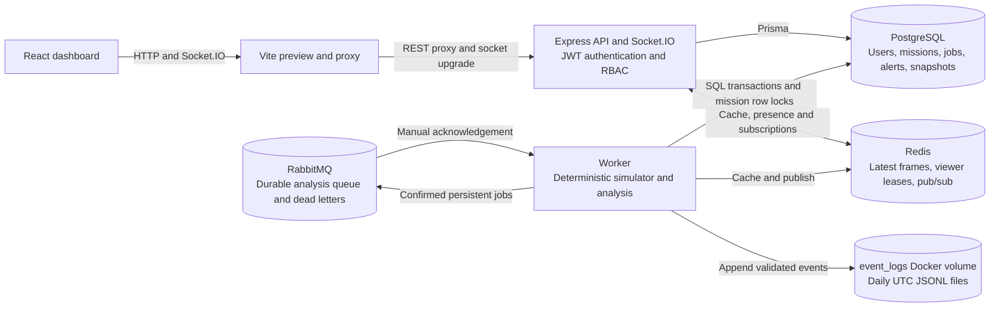
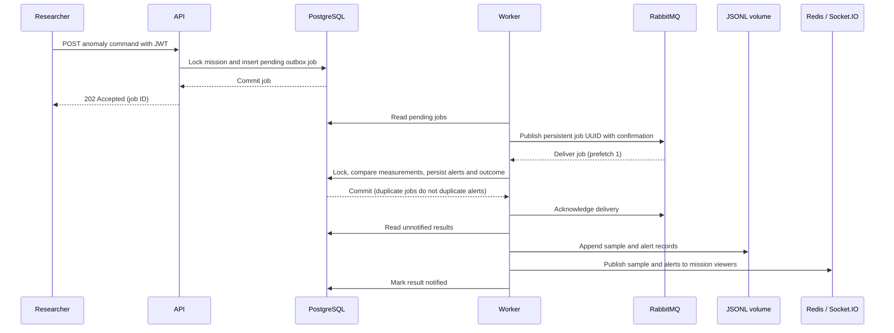

# Architecture

AERQYN runs one local API and one worker. All drones and injected anomalies are
synthetic. There are no physical UAV interfaces, real GPS feeds or external
flight commands.

Web and API share the `frontend` network. API, worker, PostgreSQL, Redis and
RabbitMQ share `backend`. The worker has no host port. Published ports bind only
to localhost. These bridge networks support host development; backend is not an
isolated network without outbound access.

## Normal telemetry

1. A Researcher sends a start command with a JWT. The API checks the current
   database user/role and conditionally changes the mission to `RUNNING` with a
   fresh `startedAt` timestamp.
2. The worker polls active missions. A row lock serializes each tick with
   lifecycle commands. Three drones follow deterministic square routes based on
   elapsed time; duplicate interval frames do not produce duplicate broadcasts.
3. Redis stores the latest normal frame for two hours and publishes it. Selected
   frames enter PostgreSQL once per five-second bucket, plus completion. The
   worker journals newly committed snapshots after releasing the transaction.
4. The API validates each Redis event, checks run identity, and revalidates
   connected users before sending to the matching Socket.IO mission room.
5. The browser validates events and ignores older samples. Replay reads selected
   PostgreSQL snapshots independently of the Redis cache and JSONL journal.

## Anomaly analysis

The worker performs both publishing and consuming in this local MVP. The API
never needs a broker connection to accept a command. Invalid broker envelopes
go to a dead-letter queue; invalid stored payloads terminate as `INVALID` and
jobs from older runs become `STALE`.

## Storage and failure boundaries

| Store      | Purpose                                                               | Persistence and limitations                                                                             |
| ---------- | --------------------------------------------------------------------- | ------------------------------------------------------------------------------------------------------- |
| PostgreSQL | Source of truth for users, missions, accepted jobs, alerts and replay | Named volume; mission deletion cascades to its jobs, alerts and snapshots                               |
| Redis      | Latest frame, expiring viewer leases, transient delivery              | AOF volume; pub/sub has no replay; crash presence expires within 45 seconds                             |
| RabbitMQ   | Asynchronous analysis delivery                                        | Durable queue and persistent messages; manual acknowledgements; database outbox retries                 |
| JSONL      | Timestamped selected simulation events                                | Append-only application writes on `event_logs`; independent of mission deletion; no automatic retention |

There is no transaction spanning database, broker, Redis and filesystem.
Snapshot journal writes happen after the database commits, so a crash or disk
failure can leave a JSONL gap while replay remains available. Journal failures
before anomaly notification leave the database result retryable; a retry can
repeat earlier journal records and Redis events. Deduplicate alerts by their
stable ID and telemetry by mission/run/elapsed time. Stop/restart suppresses
unnotified events from an earlier run, including their journal delivery.

The journal serializes writes in one worker, creates private files (`0600` on
Linux), and changes files at UTC midnight. Awaited append calls do not provide
power-loss durability or an exactly-once audit trail. There is no log HTTP API,
cryptographic tamper protection, backup service, or multi-worker coordination.

Two backend concepts to study are the **transactional outbox**, which persists
accepted work before publishing it, and **idempotency**, which makes repeated
deliveries safe for durable alert/snapshot creation. Neither guarantees exactly
one notification across independent systems.
