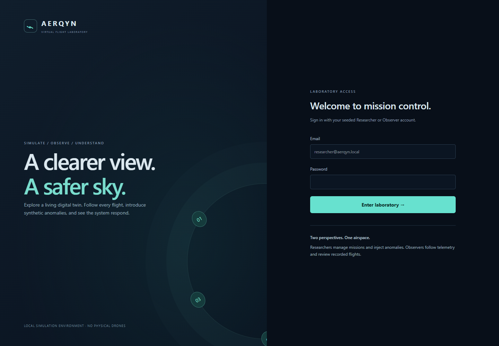
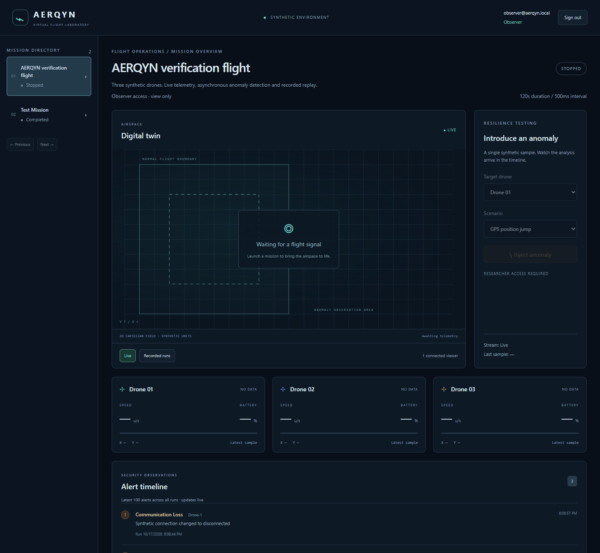
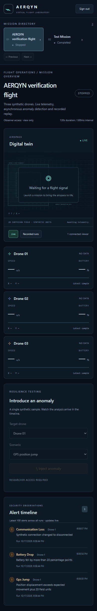

# Project demo

The [recorded browser demo](media/demo.webm) shows the actual local Compose stack,
captured with Microsoft Edge on 2026-10-17. It has no audio narration. It covers
Researcher login, mission creation/launch, moving drones, all three injected
anomalies and live alerts, stop/replay, Observer restrictions and a mobile viewport.
The capture deletes only its own temporary mission afterward. Existing missions
are left intact; journal records remain on the log volume.

## Screenshots

| Login                                | Mission dashboard                                |
| ------------------------------------ | ------------------------------------------------ |
|  |  |

| Detected alerts                                     | Recorded replay                            |
| --------------------------------------------------- | ------------------------------------------ |
|  |  |

| Observer                                                       | Mobile (390px wide)                           |
| -------------------------------------------------------------- | --------------------------------------------- |
|  |  |

## Repeat the demonstration

1. Follow the README's Docker setup and seed both accounts. Open
   <http://localhost:5173> and use the credentials in your local `.env`.
2. Create a 120-second mission with a 500ms telemetry interval, then launch it.
3. Use another browser profile/private session to sign in as Observer. Both
   sessions should see movement and two connected viewers. Observer writes must
   also be rejected by the API, independent of disabled buttons.
4. Inject GPS position jump, sudden battery drop and communication loss.
   Each accepted command is analyzed asynchronously and appears in the timeline.
5. Stop the mission, select **Recorded runs**, then play or scrub selected frames.
   Replay contains normal snapshots; injected samples remain journal events and
   their alerts remain a separate history.
6. Inspect daily JSONL files and run the verification commands in README.

## Regenerate the media

Browser capture is an optional documentation tool. It does not add a production
or workspace dependency. On Windows with Edge installed:

```sh
npm install --prefix .cache/browser --no-save --package-lock=false playwright
node .cache/browser/node_modules/playwright/cli.js install ffmpeg
node --env-file-if-exists=.env scripts/capture-demo.mjs
```

Run from the repository root with the Docker stack healthy and both accounts
seeded. The script targets localhost only; `SIMULATION_ORIGIN` can select another
local port. It overwrites the six PNGs and `docs/media/demo.webm`, checks visible
movement, three alert entries, replay availability, disabled Observer controls,
absence of page exceptions and mobile horizontal overflow. It records password
fields as masked browser inputs; tokens and credentials are never printed.
Review media before sharing if you customize account emails or mission names.

Screenshots were visually inspected at desktop and mobile sizes. Automation is
not an exhaustive accessibility, keyboard-navigation or cross-browser audit.
